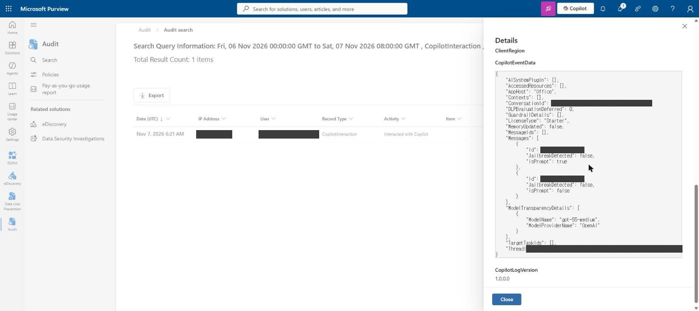
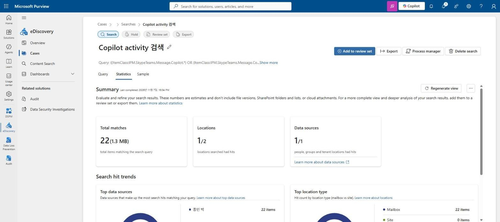
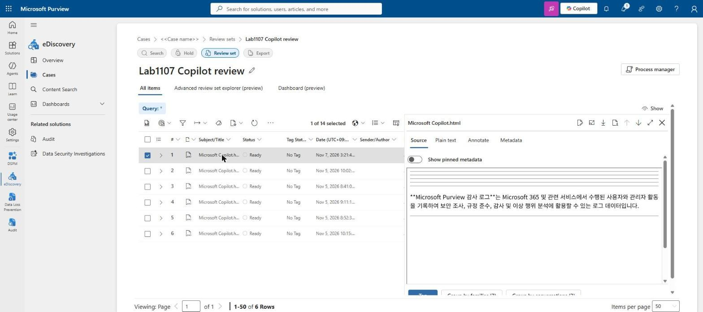
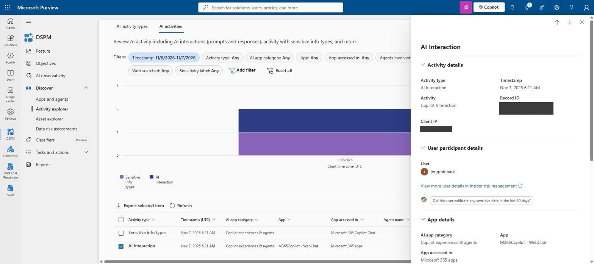
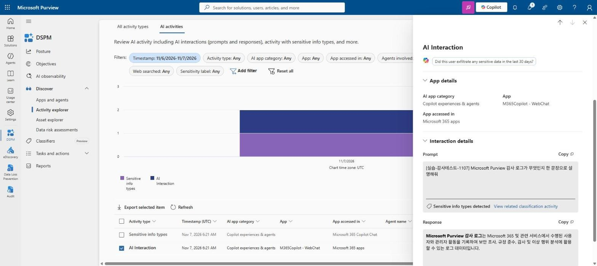

Copilot 운영에서 자주 나오는 질문은 "누가 Copilot에 무엇을 물어봤는지 볼 수 있는가"다. 공식 문서 기준으로는 감사 로그에 상호작용 기록이 남고, 프롬프트와 응답은 사용자 사서함에 저장되며, eDiscovery와 DSPM으로 볼 수 있다. 이 글은 그 설명을 [M365 개발자 샌드박스](/iam/m365-readiness-remediation-2/)에서 직접 확인한 기록이다. 테스트 프롬프트 1건을 보내고, 같은 대화가 세 도구에서 각각 어떻게 보이는지 비교했다.

> 요약
> - 감사 로그: `CopilotInteraction` 레코드 1건. 사용자, IP, 앱(`Copilot.M365Copilot.WebChat`), 라이선스 유형, 모델 이름, 메시지 ID는 있지만 **프롬프트 원문은 없다**.
> - eDiscovery: Item class를 `Copilot activity`로 지정하면 조건이 `ItemClass:IPM.SkypeTeams.Message.Copilot.*`로 바뀐다. 22건이 모두 **사서함**에서 나왔고 사이트는 0건이었다. 리뷰 세트에 넣은 뒤 응답 원문을 열람했다.
> - DSPM: Discover > Activity explorer > AI activities 탭에서 **프롬프트와 응답이 모두 보였다**.
> - 권한: PIM으로 전역 관리자를 활성화해도 감사 검색 생성 요청은 403이었다. Purview 역할 그룹 **Audit Manager**에 추가하고 다시 로그인한 뒤 200으로 바뀌었다. 화면에는 오류 메시지가 없었다.
> - 이 테넌트의 DSPM 배너에는 classic 종료일이 **2026-11-30**으로 표시됐다. 외부 미러로 본 메시지 센터 공지(MC1481315, 2027년 3월)와 다르다.

## 0. 환경과 테스트 데이터

| 항목 | 값 |
|---|---|
| 테넌트 | M365 개발자 프로그램 샌드박스 |
| 라이선스 | Microsoft 365 E5 Developer SKU V2 (without Windows and Audioconferencing), 25개 중 17개 할당. Microsoft Entra ID P2 1개 |
| Copilot | 유료 Microsoft 365 Copilot 라이선스 없음. Copilot Chat 화면 왼쪽 아래 표시는 "Copilot Chat(무료)" |
| 실습 계정 | 샌드박스 사용자 1명. 전역 관리자는 PIM **적격(Eligible)** 할당 |
| 브라우저 | Chrome. 회사 계정과 샌드박스 계정이 같은 브라우저에 로그인돼 있어, 단계마다 오른쪽 위 계정을 확인했다 |

테스트 프롬프트는 m365.cloud.microsoft/chat에서 보냈다. 다른 기록과 구분하려고 앞에 태그를 붙였다.

```text
[실습-감사테스트-1107] Microsoft Purview 감사 로그가 무엇인지 한 문장으로 설명해줘
```

전송 시각은 2026-11-07 06:21:46 UTC(15:21 KST)다. 파일 참조나 웹 검색이 필요 없는 질문으로 골랐다.

## 1. 권한 준비 — 화면에는 안 보이는 403

### 1-1. 증상

Purview 포털(purview.microsoft.com) > Audit > Search에서 처음 본 상태는 이랬다.

- 상단에 "Sorry, we're having trouble figuring out if activity is being recorded. Try refreshing the page." 문구가 나왔다.
- 날짜, 작업명, 사용자 등 검색 조건 입력란이 모두 비활성화돼 있었다.
- 새로고침하면 왼쪽 레일에서 Audit, Data Loss Prevention 항목이 사라지고 Related solutions(eDiscovery, Data Security Investigations)만 남았다.
- 이전에 만든 감사 검색 3건은 목록에 보였다. 결과 건수(7, 4, 2)는 있는데 열면 행이 비어 있었다.

M365 관리 센터(admin.cloud.microsoft) > Billing > Your products는 아래 메시지로 막혔다.

```text
Switch to an account that has permission
Your account (<user>@<tenant>.onmicrosoft.com) doesn't have permission to view or manage this page in the Microsoft 365 Admin center
Were you recently given admin access? Sign in again to apply the changes.
```

### 1-2. PIM 활성화와 토큰

계정의 전역 관리자는 적격 할당이었다. Entra 관리 센터 > Identity Governance > Privileged Identity Management > 내 역할 > Microsoft Entra 역할에서 활성화했다. 기간은 8시간, 사유는 필수 입력이다.

활성화 직후에 확인한 내용은 다음과 같다.

| 시점 | 관찰 |
|---|---|
| 활성화 직후 | "활성 할당이 변경되었습니다" 알림이 떴지만 **활성 할당** 탭은 비어 있었다 |
| 같은 역할로 다시 활성화 시도 | `The Role assignment already exists.` 오류 |
| 활성 할당 탭 새로고침 후 | 전역 관리자, 상태 "활성화됨", 종료 시간 23:29 |
| 관리 센터 재접속(기존 세션) | 여전히 권한 없음 |
| 브라우저 재시작, 쿠키 삭제 후 재로그인 | 관리 센터 정상 진입. 라이선스 목록 확인 가능 |

활성화 직후 활성 할당 탭이 비어 보이는 것은 표시 지연이었다. 다시 시도하면 `already exists`가 나온다. 포털은 활성화 전에 발급된 토큰을 계속 쓰므로 다시 로그인해야 권한이 반영된다. 이 동작은 [지난 글](/iam/m365-readiness-remediation-2/)에서 구독 Owner를 PIM으로 바꿀 때와 같았다.

### 1-3. 전역 관리자로도 감사 검색이 403

재로그인 후 감사 검색 입력란은 활성화됐다. 그런데 Search를 누르면 입력값만 초기화되고 검색 작업이 목록에 생기지 않았다. 오류 문구는 없었다. 두 번 반복해 같은 결과가 나와서 브라우저 네트워크 요청을 확인했다.

```text
POST https://purview.microsoft.com/apiproxy/adtsch/AuditLogSearch/<search-guid>   403
GET  https://purview.microsoft.com/apiproxy/adtsch/AuditLogSearch?pageSize=150      200
```

검색 목록 조회(GET)는 되고, 검색 생성(POST)만 403이었다. Purview > Settings > Roles and scopes > Role groups를 열어 보니 기본 제공 역할 그룹 79개의 Users가 **모두 0**이었다. Audit Manager, Audit Reader, eDiscovery Manager, Organization Management도 마찬가지였다.

공식 문서는 감사 로그 검색에 필요한 권한을 이렇게 설명한다.

> Admins and members of investigation teams must be assigned the View-Only Audit Logs or Audit Logs role in the Microsoft Purview portal to search or export the audit log. By default, the Microsoft Purview portal Role groups page assigns these roles to the Audit Reader and Audit Manager role groups.

같은 문서에 전역 관리자만으로 충분한지에 대한 언급은 없다. 실측에서는 전역 관리자가 활성화된 상태에서도 POST가 403이었다.

### 1-4. 역할 그룹 추가

실습에 필요한 역할 그룹 네 개에 계정을 추가했다. 경로는 Purview > Settings > Roles and scopes > Role groups > 그룹 이름 클릭 > Members > Add member다.

| 역할 그룹 | 포함 역할(화면 기준) | 용도 |
|---|---|---|
| Audit Manager | Audit Logs, View-Only Audit Logs | 감사 검색·내보내기 |
| eDiscovery Manager | (Add Managers / Add Administrators 중 **Managers**에 추가) | 사건 생성, 검색, 리뷰 세트 |
| Data Security Management | — | DSPM |
| Data Security AI Content Viewers | — | DSPM에서 프롬프트·응답 열람 |

eDiscovery Manager 그룹은 Members 탭에 버튼이 두 개다. Add Managers에 넣으면 "eDiscovery Manager (1)" 아래에 표시된다.

추가 직후에는 여전히 403이었다. 브라우저를 재시작하고 다시 로그인한 뒤 같은 요청이 200으로 바뀌었다.

```text
POST https://purview.microsoft.com/apiproxy/adtsch/AuditLogSearch/<search-guid>   200
```

## 2. 감사 로그 — 무엇을 했는지는 있고 무엇을 물었는지는 없다

### 2-1. 검색 조건

| 항목 | 값 |
|---|---|
| Date and time range (UTC) | 2026-11-06 00:00 ~ 2026-11-07 08:00 |
| Activities - operation names | `CopilotInteraction` |
| Search name | Lab1107 CopilotInteraction |

종료 날짜 선택기는 오늘(11/7)까지만 고를 수 있다. 기본값이 11/7 00:00이어서 그대로 두면 오늘 발생한 기록은 범위 밖이 된다. 종료 시각을 08:00으로 바꿨다.

검색은 15:54 KST에 생성됐다. 진행률이 0%로 시작해 약 1분 뒤 Completed가 됐고 결과는 1건이었다. 프롬프트를 보낸 시각(15:21 KST)으로부터 약 33분 뒤에 검색했고, 그 시점에 이미 레코드가 들어와 있었다. 수집 지연은 한 번 관찰한 값이므로 기준으로 삼지 않는다.

### 2-2. 레코드 필드



| 필드 | 값 |
|---|---|
| Date (UTC) / CreationTime | 2026-11-07T06:21:46 |
| Operation / Activity | CopilotInteraction ("Interacted with Copilot") |
| RecordType | 261 |
| Workload | Copilot |
| AppIdentity | `Copilot.M365Copilot.WebChat` |
| UserId / ClientIP | (마스킹) |
| CopilotLogVersion | 1.0.0.0 |

`CopilotEventData`는 JSON 문자열이다. 펼친 값은 다음과 같다. ID 값은 마스킹했다.

```json
{
  "AISystemPlugin": [],
  "AccessedResources": [],
  "AppHost": "Office",
  "Contexts": [],
  "ConversationId": "<masked>",
  "DLPEvaluationDeferred": 0,
  "GuardrailDetails": [],
  "LicenseType": "Starter",
  "MemoryUpdated": false,
  "MessageIds": [],
  "Messages": [
    { "Id": "<masked>", "JailbreakDetected": false, "isPrompt": true },
    { "Id": "<masked>", "JailbreakDetected": false, "isPrompt": false }
  ],
  "ModelTransparencyDetails": [
    { "ModelName": "gpt-55-medium", "ModelProviderName": "OpenAI" }
  ],
  "TargetTaskIds": [],
  "ThreadId": "<masked>@thread.v2"
}
```

레코드에서 확인한 내용은 다음과 같다.

- 프롬프트 1개와 응답 1개가 `Messages` 배열에 `isPrompt` true/false로 구분돼 있다. 둘 다 ID와 `JailbreakDetected` 값만 있고 **본문은 없다**.
- 파일이나 웹을 참조하지 않은 질문이라 `AccessedResources`와 `Contexts`가 비어 있다.
- 유료 Copilot 라이선스가 없는 사용자의 기록이고 `LicenseType`은 `Starter`다. 무료 Copilot Chat 사용도 감사 대상이라는 것을 이 레코드로 확인했다.
- `ConversationId`는 Copilot Chat 주소창의 `/chat/conversation/<id>` 값과 같았다. 감사 레코드에서 실제 대화 화면을 역추적할 때 쓸 수 있다.
- `ThreadId` 형식(`19:...@thread.v2`)은 Teams 채팅 스레드 ID와 같다. 3장에서 eDiscovery가 이 대화를 Teams 메시지 계열 Item class로 찾는 것과 맞물린다.
- `ModelTransparencyDetails`에 응답 모델 이름과 제공자가 기록됐다.

## 3. eDiscovery — 사서함에 저장된 원문

### 3-1. 사건과 검색 만들기

Purview > eDiscovery > Cases > Create case에서 사건을 만들었다. 기본값으로 **eDiscovery (Premium)** 토글이 켜져 있다. 사건 안에서 Create a search로 검색을 만들고 아래처럼 구성했다.

1. Data sources > Add sources에서 실습 사용자를 검색해 선택했다. "Locations to include"는 기본값(Mailboxes and sites)을 그대로 뒀다. 데이터 원본 옆에 Exchange(사서함)와 OneDrive 아이콘이 함께 붙는다.
2. Condition builder > Add conditions > Show more에서 조건을 추가했다. 패널 상단에 "The condition **Type** has been renamed to **Item class**" 안내가 있다. Item class를 검색해 체크하고 Apply를 눌렀다.
3. Item class 값 입력란에 `Copilot`을 입력하면 제안 목록에 **Copilot activity**가 나온다. 이것을 선택하자 Query가 자동으로 바뀌었다.

```text
((ItemClass:IPM.SkypeTeams.Message.Copilot.*) OR (ItemClass:IPM.SkypeTeams.Message.Co... (이하 생략 표시)
```

화면에는 앞부분만 보이고 나머지는 "Show more"로 접혀 있다. Copilot 대화가 사서함 안에 Teams 메시지 계열 항목(`IPM.SkypeTeams.Message.Copilot.*`)으로 저장된다는 것을 이 쿼리로 확인할 수 있다.

### 3-2. 통계

Run query를 누르면 "Choose search results" 패널이 열리고 Statistics와 Sample 중 하나를 고르게 한다. 처음 실행할 때는 Sample이 비활성화돼 있어 Statistics로 실행했다. 상태는 "Assessing request, 0 locations identified"에서 몇 분 머문 뒤 완료됐다.



| 지표 | 값 |
|---|---|
| Total matches | 22 (1.3 MB) |
| Locations | 1 / 2 (검색한 위치 2곳 중 1곳에서 일치) |
| Data sources | 1 / 1 |
| Top location type | Mailbox 22, Site 0 |

검색 대상 위치는 사서함과 OneDrive 2곳이고, 일치 항목은 전부 사서함에서 나왔다. 공식 문서의 설명과 같은 결과다.

> Because user prompts and responses for AI apps are stored in a user's mailbox, you can create a case and use search...

22건에는 이번 테스트 프롬프트 외에 11/5에 같은 계정으로 남긴 대화도 포함돼 있다. 통계를 한 번 실행한 뒤에는 검색 화면에 **Sample** 탭이 생기고, "Generate sample results"로 표본을 만들 수 있다.

### 3-3. 리뷰 세트에서 원문 열람

원문은 리뷰 세트에서 확인했다. Add to review set > Add to new review set에 이름을 넣고 실행했다. 패널 상단에는 아래 안내가 표시된다.

```text
New pay-as-you-go billing model in effect. Your organization may get billed for processing and storage of
Non M365 AI interactions including Microsoft Copilot experiences, enterprise AI, and other AI apps.
There are no charges for M365 Copilot interactions.
```

이번 데이터는 M365 Copilot 대화뿐이라 과금 대상이 아니라고 판단하고 진행했다. 리뷰 세트 크기는 처음에 0 B로 보이다가 약 1분 뒤 새로고침하자 1.48 MB로 바뀌었다.



| 항목 | 값 |
|---|---|
| 목록 | 6행 (14 items). 항목 이름은 모두 `Microsoft Copilot.html` |
| 상태 | Ready, No Tag |
| 미리보기 탭 | Source / Plain text / Annotate / Metadata |
| 11/7 항목 Source | 응답 원문 "**Microsoft Purview 감사 로그**는 Microsoft 365 및 관련 서비스에서 수행된 사용자와 관리자 활동을 기록하여…" |
| 하단 버튼 | Group by families (2), Group by conversations (2) |

통계 추정치는 22건이었고 리뷰 세트에는 14개 항목이 들어왔다. 통계 화면에는 "These numbers are estimates"라고 적혀 있다. 두 숫자가 다른 이유는 이번에 따로 확인하지 않았다. 같은 대화의 프롬프트 항목은 Group by conversations(2)로 묶여 있다.

## 4. DSPM — 프롬프트와 응답이 함께 보인다

### 4-1. 진입 화면

Purview > DSPM에 처음 들어가면 "DSPM and DSPM for AI unified in one solution" 안내 창과 **Get started** 버튼이 나온다. Get started는 테넌트 단위 설정이라 사용자가 직접 눌렀다. 상단에는 이런 배너가 고정돼 있다.

```text
Data Security Posture Management (classic) and Data Security Posture Management for AI (classic)
will be retired on November 30, 2026. All features from the classic solutions and your data are
available now in the new DSPM.
```

외부 미러 사이트로 본 메시지 센터 공지 MC1481315(최종 업데이트 2026-10-30)에는 종료 시점이 "2027년 3월 중순~말"로 적혀 있었다. 이 테넌트 배너의 날짜와 다르다. 실제 일정은 각 테넌트의 메시지 센터 원문으로 확인해야 한다.

왼쪽 메뉴 구성은 다음과 같다. Discover 아래 항목은 공식 매핑 표(classic → current)와 같다.

```text
DSPM
├─ Posture
├─ Objectives
├─ AI observability
├─ Discover
│   ├─ Apps and agents
│   ├─ Activity explorer      ← classic의 Activity explorer
│   ├─ Asset explorer
│   └─ Data risk assessments  ← classic의 Data risk assessments
├─ Classifiers (Preview)
├─ Tasks and actions
└─ Reports
```

### 4-2. AI activities 탭

Discover > Activity explorer에는 탭이 두 개 있다. **All activity types** 탭은 비어 있었고, **AI activities** 탭에 2건이 나왔다.



기본 필터는 Timestamp(11/6~11/7), Activity type, AI app category, App, App accessed in, Agents involved, User participant, Sensitive info type, Web searched, Sensitivity label이다.

| Activity type | Timestamp (UTC) | AI app category | App | App accessed in | Sensitive info type | Web searched |
|---|---|---|---|---|---|---|
| Sensitive info types | 11/7 6:21 AM | Copilot experiences & agents | — | Microsoft 365 Copilot Chat | All Full Names | — |
| AI Interaction | 11/7 6:21 AM | Copilot experiences & agents | M365Copilot - WebChat | Microsoft 365 apps | — | No |

AI Interaction 행을 열면 상세 패널이 나온다. Record ID는 감사 레코드의 `Id`와 같은 값이었다. DSPM이 감사 로그와 같은 이벤트를 쓴다는 뜻이다.



| 섹션 | 표시 내용 |
|---|---|
| Activity details | Activity type, Timestamp, Activity(Copilot Interaction), Record ID, Client IP |
| User participant details | 사용자, Insider Risk Management 사용자 상세 링크 |
| App details | AI app category, App, App accessed in |
| Interaction details | **Prompt 원문**, "Sensitive info types detected", **Response 원문**, 각각 Copy 버튼 |

프롬프트에는 사람 이름이 없는데 Sensitive info type으로 "All Full Names"가 검출됐다. 어떤 문자열이 검출됐는지는 이번에 확인하지 않았다.

프롬프트와 응답 열람 권한은 DSPM for AI(classic) 문서에 "Microsoft Purview Content Explorer Content Viewer" 역할 그룹으로 안내돼 있다. 이번 실습에서는 계정을 Data Security AI Content Viewers 그룹에 넣은 상태에서 원문이 보였다. Content Explorer Content Viewer 그룹에는 넣지 않았다.

## 5. 세 도구 비교

같은 이벤트(11/7 06:21:46 UTC)를 기준으로 정리했다.

| 질문 | 감사 (Audit) | eDiscovery | DSPM (AI activities) |
|---|---|---|---|
| 누가, 언제, 어떤 앱에서 | O | O (항목 메타데이터) | O |
| 프롬프트 원문 | **X** (메시지 ID만) | O (리뷰 세트) | **O** |
| 응답 원문 | **X** | O (리뷰 세트) | **O** |
| 참조 파일, 웹 검색 여부 | AccessedResources | — | Web searched 열 |
| 민감 정보 유형 | — | — | Sensitive info type 열 |
| 모델 이름 | O (ModelTransparencyDetails) | — | — |
| 보존(Hold), 내보내기 | 내보내기만 | O | Export selected item |
| 필요 역할 그룹(이번 실습) | Audit Manager | eDiscovery Manager | Data Security Management, Data Security AI Content Viewers |
| 결과까지 걸린 시간(이번 실습) | 검색 약 1분 | 통계 수 분, 리뷰 세트 약 1분 | 화면 진입 즉시 |

운영 기준으로 정리하면 이렇다.

- "Copilot을 썼는가, 언제 썼는가"는 감사 로그로 확인한다. 원문은 없다.
- "무엇을 묻고 무엇을 답했는가"를 빠르게 보려면 DSPM AI activities를 쓴다.
- 조사나 법무 목적으로 원문을 수집, 보존, 내보내야 하면 eDiscovery 사건과 리뷰 세트를 쓴다.
- 세 도구 모두 Purview 역할 그룹 권한이 따로 필요하다. 전역 관리자 활성화만으로는 감사 검색이 403이었다.

## 6. 확인하지 못한 것

- 감사 로그 수집 지연: 이번에는 33분 뒤 검색에서 레코드가 있었다. 실제 지연 시간은 측정하지 않았다.
- eDiscovery 통계 22건과 리뷰 세트 14개 항목의 차이.
- DSPM에서 "All Full Names"가 검출된 문자열.
- DSPM classic 종료일: 테넌트 배너는 2026-11-30, 미러로 본 MC1481315는 2027년 3월이다.
- 전역 관리자만으로 감사 검색이 403인 것이 의도된 설계인지에 대한 공식 문서 근거.

## 참고

- [Get started with auditing solutions — Microsoft Learn](https://learn.microsoft.com/purview/audit-get-started)
- [Microsoft Purview data security and compliance protections for Microsoft 365 Copilot — Microsoft Learn](https://learn.microsoft.com/purview/ai-m365-copilot)
- [Learn about Data Security Posture Management — Microsoft Learn](https://learn.microsoft.com/purview/data-security-posture-management-learn-about)
- [DSPM task mapping (classic → current) — Microsoft Learn](https://learn.microsoft.com/purview/dspm-task-mapping)
- [Data Security Posture Management for AI (classic) — Microsoft Learn](https://learn.microsoft.com/purview/dspm-for-ai)
- [Microsoft 365 Developer Program FAQ — Microsoft Learn](https://learn.microsoft.com/office/developer-program/microsoft-365-developer-program-faq)
