Copilot 운영 P1 사전 검증 항목 중 D3(사용자·테넌트 통제)에 해당하는 세 가지를 하나의 시나리오로 묶어 [M365 개발자 샌드박스](/iam/m365-readiness-remediation-2/)에서 재현했다.

| ID | 항목 | 이번에 확인한 것 |
|---|---|---|
| V05 | 개인 Microsoft 계정 | 회사 PC에서 개인 계정 로그인이 차단되는가 |
| V06 | 외부 테넌트 | 승인하지 않은 테넌트는 차단되고, 승인한 테넌트는 허용되는가 |
| V07 | TRv2 적용 | 정책만 있을 때와 단말에서 신호를 켰을 때 결과가 달라지는가, 어떤 경로가 보호 범위 밖인가 |

> 요약
> - TRv2 기본 정책은 샌드박스에 이미 "외부 사용자·앱 모두 차단"으로 있었다. 단말 신호가 없어 아무 곳에도 적용되지 않던 상태였다.
> - Entra 조인 Windows 10 VM에 로컬 그룹 정책으로 신호를 켜자, Edge에서 개인 계정은 `80045C4D`, 미승인 테넌트 계정은 `AADSTS5000211`로 차단됐다. 샌드박스 자체 계정은 그대로 로그인됐다.
> - 홈랩 테넌트를 조직 설정에 추가하고 테넌트 제한을 허용으로 바꾸자, 같은 VM·계정·URL로 로그인됐다. 정책 ID가 그대로라 VM 쪽 GPO는 바꾸지 않았다.
> - 같은 개인 계정으로 Chrome 시크릿 창에서는 차단되지 않았다. Windows GPO 방식은 Edge와 Office 앱만 보호한다는 공식 문서 설명과 같다.
> - 고객사 프록시 헤더 방식, 사내·VPN·모바일 경로별 결과는 이번 범위가 아니다.

## 0. 환경

| 항목 | 값 |
|---|---|
| 정책 테넌트 | M365 E5 개발자 샌드박스 (Entra ID P2) |
| 시험 PC | 홈랩 Hyper-V VM `WIN10-CL01`, Windows 10 Pro 22H2 (빌드 19045.6456), 샌드박스에 Entra 조인 (`AzureAdJoined : YES`) |
| 적용 방식 | 로컬 그룹 정책 (`gpedit.msc`) |
| 시험 계정 | 샌드박스 사용자 1명, 홈랩 테넌트(`Default Directory`) 사용자 `user01`, 개인 Microsoft 계정 1개 |
| 브라우저 | Edge InPrivate, Chrome 시크릿 창 |

테넌트 ID, 정책 ID, 샌드박스 테넌트 이름, 요청·상관 관계 ID, IP 주소는 이미지에서 가렸다.

## 1. TRv2가 동작하는 구조

공식 문서 기준으로 TRv2는 두 부분으로 나뉜다.

| 구분 | 위치 | 역할 |
|---|---|---|
| 정책 | Entra → 외부 ID → 테넌트 간 액세스 설정 → 테넌트 제한 | 어떤 외부 테넌트·계정·앱을 허용할지 정의 |
| 신호 | 단말 또는 네트워크 | 로그인 요청에 "이 테넌트의 이 정책을 적용하라"는 표시를 붙임 |

정책만 있고 신호가 없으면 아무 것도 막지 않는다. 신호를 붙이는 방식은 세 가지다.

| 방식 | 보호 범위 (공식 문서) |
|---|---|
| Global Secure Access (유니버설 TRv2) | 모든 플랫폼의 인증 단계, 데이터 단계는 Microsoft Graph만 |
| 회사 프록시 헤더 삽입 | 인증 단계만. Teams 모임·SharePoint 파일 익명 접근은 막지 않음 |
| Windows GPO | Windows의 인증·데이터 단계. Edge와 Edge 안의 모든 사이트, Office 앱, UWP .NET 앱 |

Windows GPO 방식은 Chrome, Firefox, .NET 앱을 보호하지 않는다. 이들까지 막으려면 App Control for Business(WDAC)와 방화벽 보호 설정을 함께 써야 한다. 7장의 Chrome 시험이 이 부분을 확인한 것이다.

개인 Microsoft 계정은 TRv2에서 별도 헤더가 아니라 외부 조직처럼 다룬다. Microsoft 계정 테넌트 ID(`9188040d-6c67-4c5b-b112-36a304b66dad`) 기준으로 평가되고, 사용자 단위 지정은 지원하지 않는다. Copilot Chat 관리 문서도 개인 계정으로 Microsoft 365 앱에 로그인하는 것을 TRv2로 관리하라고 안내한다.

## 2. 변경 전 상태

테넌트 간 액세스 설정의 기본 설정 탭에서 테넌트 제한은 이미 "외부 사용자 및 그룹: 모두 차단 / 외부 애플리케이션: 모두 차단"이었다.

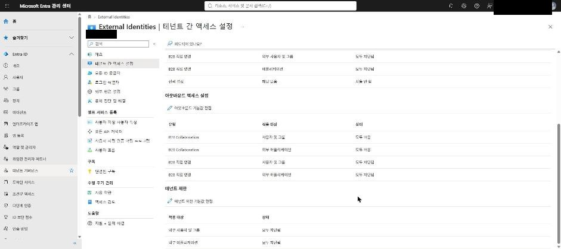

"테넌트 제한 기본값 편집"을 열면 정책 ID가 이미 만들어져 있었다. 화면에는 "TRv2 클라이언트 측 태그 지정을 사용하도록 설정하기 위한 추가 설정을 완료할 때까지 적용되지 않습니다"라는 안내가 있다. 정책은 있지만 아직 아무 단말에도 적용되지 않은 상태라는 뜻이다. 이 화면의 테넌트 ID와 정책 ID를 VM 설정에 사용했다.

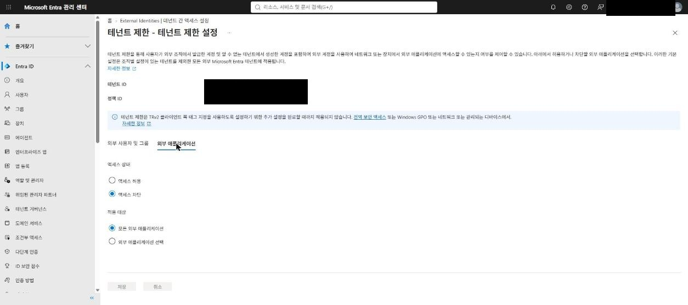

조직 설정에는 회사 테넌트 1개만 있었고, 테넌트 제한은 "기본값에서 상속됨"이었다.

## 3. Baseline (TC-00)

정책을 적용하기 전에 VM의 Edge InPrivate 창에서 세 계정으로 로그인해 봤다. 셋 다 로그인됐다.

| 계정 | URL | 결과 |
|---|---|---|
| 샌드박스 사용자 | `https://m365.cloud.microsoft/chat` | 허용 |
| 홈랩 `user01` | `https://m365.cloud.microsoft/chat` | 허용 |
| 개인 Microsoft 계정 | `https://outlook.live.com` | 허용 |

이후 시험은 같은 계정, 같은 URL로 반복했다. 바뀌는 조건을 정책 하나로 두기 위해서다.

## 4. Windows GPO로 신호 켜기

### 4-1. DC가 아니라 VM의 로컬 정책

처음에는 DC에서 도메인 GPO로 내려야 하는지 헷갈렸다. 이 VM은 azlab 도메인에서 빠져 샌드박스에 Entra 조인만 된 상태라 도메인 GPO가 적용되지 않는다. 공식 문서도 장치가 Entra 관리 대상이든, 도메인 조인 후 그룹 정책으로 관리되든 상관없다고 한다. 시험 절차 역시 PC에서 `gpedit`을 여는 방식이다.

| 장치 유형 | 배포 방법 |
|---|---|
| 도메인 조인 PC | 도메인 GPO |
| Entra 조인 PC | Intune 구성 프로필 (Policy CSP `TenantRestrictions/ConfigureTenantRestrictions`) |
| 이번 시험 VM | 로컬 GPO |

### 4-2. 폴더가 안 보였던 이유

`컴퓨터 구성 > 관리 템플릿 > Windows 구성 요소` 아래에서 `Tenant Restrictions`를 찾지 못했다. 먼저 지원 조건을 확인했다.

```powershell
Get-ItemProperty 'HKLM:\SOFTWARE\Microsoft\Windows NT\CurrentVersion' | Select DisplayVersion, CurrentBuild, UBR
Test-Path C:\Windows\PolicyDefinitions\TenantRestrictions.admx
```

```text
DisplayVersion CurrentBuild  UBR
-------------- ------------  ---
22H2           19045        6456
True
```

Policy CSP 문서 기준 지원 범위(Windows 10 21H2 [10.0.19044] 이후 등)에 들어가고 템플릿 파일도 있었다. 원인은 한국어 이름이었다. 한국어 Windows의 gpedit 목록은 영문 이름 항목 뒤에 한글 이름 항목이 이어지는데, 이 정책 폴더는 **테넌트 제한**으로 번역돼 목록 아래쪽에 있었다. 정책 이름도 `Cloud Policy Details` 대신 **클라우드 정책 세부 정보**로 표시된다.

### 4-3. 설정값

| 항목 | 값 |
|---|---|
| 상태 | 사용 (변경 전: 사용 안 함) |
| Azure AD 디렉터리 ID | 샌드박스 테넌트 ID |
| 정책 GUID | 기본 정책 ID |
| Microsoft 끝점 방화벽 보호 사용 | 체크하지 않음 (Chrome 우회를 보기 위해) |
| 클라우드 ID, 호스트 이름 | 비움 |

`gpupdate /force` 후 재부팅했다.

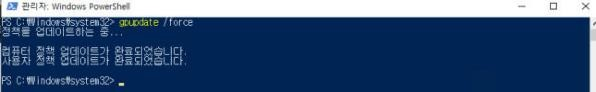

이벤트 뷰어 `응용 프로그램 및 서비스 로그 > Microsoft > Windows > TenantRestrictions > Operational`에 이벤트가 두 쌍 남았다(09:42, 09:45). 1004는 "엔드포인트 동기화 서비스(cloudidsvc)가 성공적으로 시작되었습니다", 1005는 "최신 엔드포인트 목록을 성공적으로 동기화했습니다"다. 09:45 쌍이 재부팅 후 기록이다.

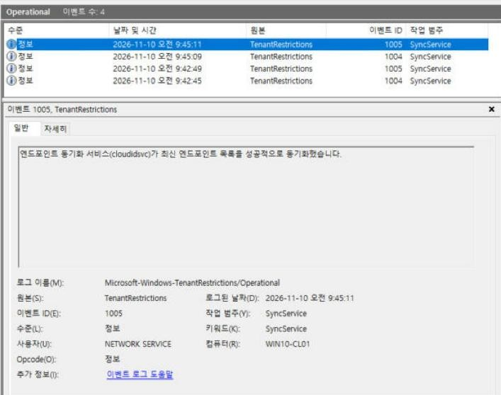

## 5. 적용 후 결과 (TC-01 ~ TC-03)

Baseline과 같은 계정·URL로 Edge InPrivate에서 다시 로그인했다.

| TC | 계정 | 기대 | 실제 |
|---|---|---|---|
| 01 | 샌드박스 사용자 | 허용 | 허용 (Copilot Chat 진입) |
| 02 | 개인 Microsoft 계정 | 차단 | 차단, `80045C4D` |
| 03 | 홈랩 `user01` | 차단 | 차단, `AADSTS5000211` |

샌드박스 사용자는 정책을 가진 테넌트 자신의 계정이라 영향이 없었다.

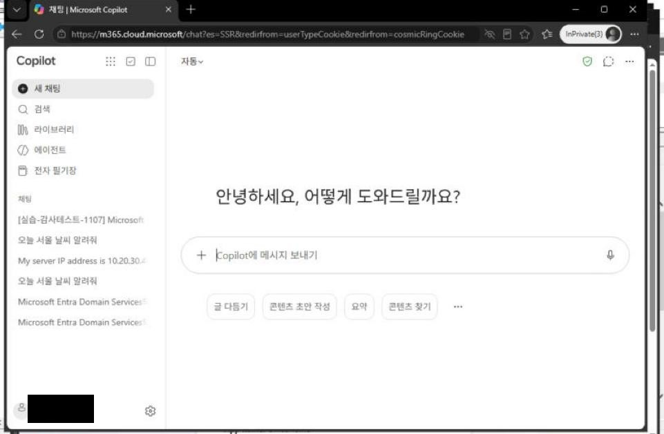

개인 계정은 login.live.com에서 "여기서는 거기에 접근할 수 없습니다"로 막혔다. 문제 해결 세부 정보의 메시지는 `Signin restricted by cross tenant access policy for consumer accounts.`이다.

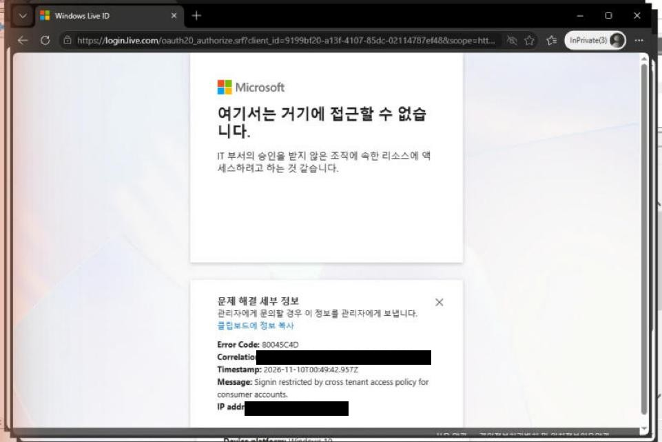

홈랩 계정은 login.microsoftonline.com에서 "액세스가 차단됨"으로 막혔다. 메시지는 `AADSTS5000211: A tenant restrictions policy added to this request by a device or network administrator does not allow access to 'Default Directory'.`이고, 앱 이름은 OfficeHome이다.

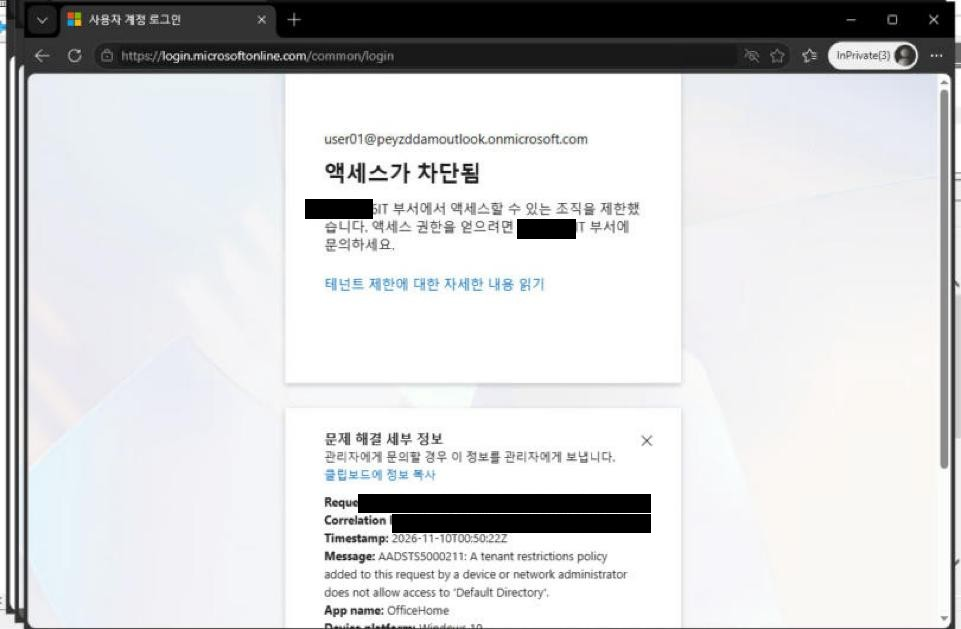

같은 기본 정책인데 개인 계정과 Entra 계정은 차단되는 위치, 화면, 오류 코드가 다르다. P1 판정 기준에는 두 코드를 모두 적어 두는 게 맞다.

## 6. 승인 테넌트 예외 (TC-04)

조직 설정에 홈랩 테넌트를 추가했다. 도메인을 입력하면 테넌트 이름(`Default Directory`)과 테넌트 ID가 조회된다. 추가 직후에는 인바운드·아웃바운드·테넌트 제한이 모두 "기본값에서 상속됨"이라 동작은 바뀌지 않는다.

테넌트 제한 열을 눌러 "사용자 지정 설정"으로 바꾸고, 외부 사용자 및 그룹과 외부 애플리케이션을 모두 "액세스 허용"으로 저장했다.

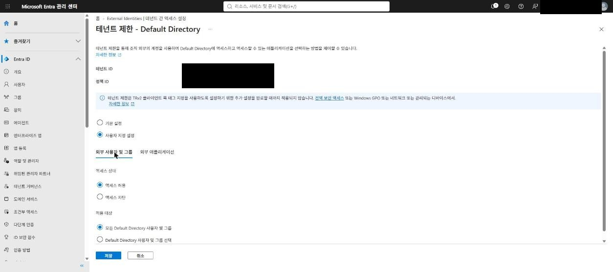

저장 알림만 보고 끝내지 않고 목록을 다시 불러와, 홈랩 테넌트의 테넌트 제한 열이 "구성됨"으로 바뀐 것을 확인했다. 인바운드·아웃바운드 B2B 설정은 그대로 상속 상태다.

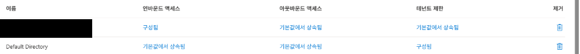

조직별 화면에도 정책 ID가 기본 정책과 같게 표시된다. Entra가 로그인할 때마다 이 정책을 평가하므로 VM의 GPO는 바꾸지 않았다. 같은 VM, 같은 계정(`user01`), 같은 URL로 새 InPrivate 창에서 다시 로그인하자 이번에는 들어가졌다. 계정 카드에 `Default Directory`와 `user01` UPN이 보인다.

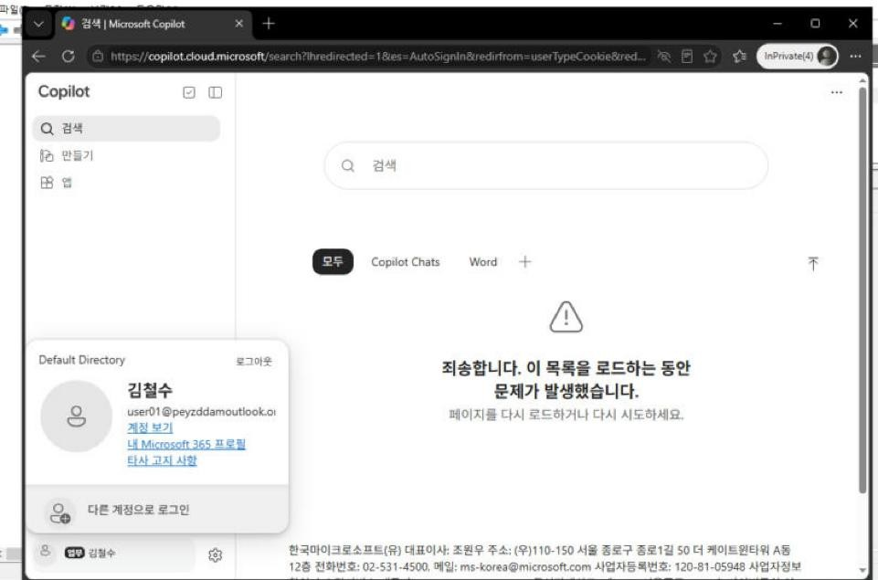

로그인 뒤 Copilot 검색 화면에 "목록을 로드하는 동안 문제가 발생했습니다"가 떴다. 인증은 통과했으므로 TRv2 차단은 아니다. user01의 라이선스 때문인지 다른 원인인지는 확인하지 않았다.

| Scenario | 기대 | 실제 |
|---|---|---|
| 회사(정책) 테넌트 | 허용 | 허용 |
| 미승인 테넌트 | 차단 | 차단 |
| 승인 테넌트 | 허용 | 허용 |

## 7. Chrome 우회 (TC-07a)

승인 예외를 넣은 상태에서 개인 계정으로 두 브라우저를 비교했다. 승인 예외를 받은 `user01`은 Chrome에서 로그인돼도 우회인지 예외인지 구분되지 않아서 쓰지 않았다.

| 브라우저 | 계정 | 결과 |
|---|---|---|
| Edge InPrivate | 개인 Microsoft 계정 | 차단, `80045C4D` (10:07:32 KST) |
| Chrome 시크릿 | 같은 개인 Microsoft 계정 | 로그인됨, outlook.live.com 메일함 표시 |

Edge 결과는 승인 예외를 추가한 뒤에도 개인 계정 차단이 그대로라는 대조군도 겸한다.

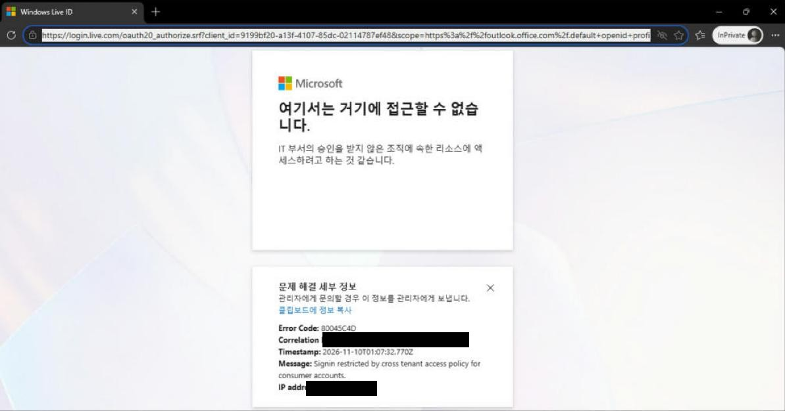

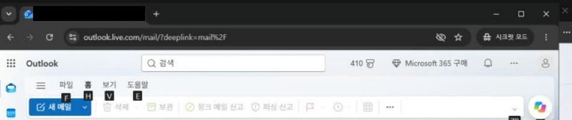

Chrome 화면은 메일 목록이 보여 상단만 잘랐다. 주소창의 outlook.live.com/mail과 시크릿 모드 표시로 로그인 후 화면임을 확인할 수 있다.

## 8. 정리

### 확인한 것

- TRv2 정책은 신호가 없으면 아무 곳에도 적용되지 않는다. 포털 안내 문구와 Baseline 결과가 같았다.
- Windows GPO 신호를 켜면 Edge에서 개인 계정(`80045C4D`)과 미승인 테넌트 계정(`AADSTS5000211`)이 각각 다른 위치에서 차단된다. 정책을 가진 테넌트의 자기 계정은 영향을 받지 않는다.
- 조직 설정에서 특정 테넌트만 허용하면, VM 설정은 그대로 둔 채 그 테넌트만 다시 로그인된다.
- Windows GPO 방식은 Chrome을 보호하지 않는다. 단말 GPO만으로는 V05·V06 통제가 Edge·Office 경로에만 걸린다.
- 한국어 Windows에서 정책 폴더는 "테넌트 제한", 정책 이름은 "클라우드 정책 세부 정보"로 표시된다.

### 고객환경에서 확인할 것

- 법인 PC 관리 방식 (도메인 GPO인지 Intune인지)
- Edge 외 브라우저 사용 허용 여부. 허용한다면 WDAC와 방화벽 보호를 함께 쓸지, 프록시 헤더 방식으로 갈지
- 프록시 헤더 방식은 인증 단계만 보호한다. Teams 모임·SharePoint 파일의 익명 접근은 막지 않는다.
- 사내 LAN, VPN, 재택, 모바일, 프록시 우회 경로별 결과

### 하지 않은 것

- WDAC와 방화벽 보호로 Chrome까지 막는 시험
- 프록시 헤더 방식, Global Secure Access 방식 (Global Secure Access 방식은 [2편](/iam/m365-trv2-universal-gsa/)에서 진행)
- 차단된 로그인이 홈랩 테넌트 로그인 로그에 어떻게 남는지 확인

### 원복 방법

| 대상 | 원복 | 원래 값 |
|---|---|---|
| VM 로컬 GPO | 클라우드 정책 세부 정보를 "사용 안 함"으로 바꾸고 `gpupdate /force`, 재부팅 | 사용 안 함 |
| 샌드박스 조직 설정 | Default Directory 행 삭제 | 회사 테넌트 1건 |
| TRv2 기본 정책 | 원복 불필요 | 이번에 변경하지 않음 |

> 정정 (2026-11-11): VM 로컬 GPO는 이 글 작성 시점에 실제로 원복하지 않았다. 다음 날 2편 시험 중 값이 남아 있는 것을 발견해 "사용 안 함"으로 바꾸고 재부팅했다. 조직 설정의 Default Directory 행은 2편에서도 그대로 사용했다.

## 참고

- [Set up tenant restrictions v2 - Microsoft Learn](https://learn.microsoft.com/entra/external-id/tenant-restrictions-v2)
- [Policy CSP - TenantRestrictions - Microsoft Learn](https://learn.microsoft.com/windows/client-management/mdm/policy-csp-tenantrestrictions)
- [Manage Microsoft Copilot Chat - Microsoft Learn](https://learn.microsoft.com/copilot/manage)
