[1편](/iam/m365-trv2-tenant-restrictions/)에서는 Entra 조인 Windows 10 VM에 로컬 그룹 정책으로 TRv2 신호를 켜고, 개인 계정·미승인 테넌트 차단과 승인 예외, Chrome 우회를 확인했다. 1편의 "하지 않은 것" 중 Global Secure Access 방식이 남아 있었다. 이번 글은 공식 문서가 권장하는 순서대로 세 단계를 진행한 기록이다.

| 단계 | 내용 | 시험 PC |
|---|---|---|
| 1 | 정책과 ID 확인 (조회만) | — |
| 2 | Windows GPO 방식 재확인 | `WIN11-CL01` (azlab 도메인 조인, 홈랩 테넌트 하이브리드 조인) |
| 3 | 유니버설 TRv2 (Global Secure Access) | `WIN10-CL01` (샌드박스 Entra 조인) |

> 요약
> - 도메인 조인 Windows 11에서도 GPO 방식 결과는 1편과 같았다. 개인 계정은 `80045C4D`로 차단, 허용 조직(홈랩 테넌트)과 샌드박스 계정은 로그인됐다.
> - 3단계 첫 시험은 무효로 처리했다. 1편에서 켠 `WIN10-CL01`의 로컬 GPO가 원복되지 않은 채 남아 있어, 차단이 GSA 때문인지 GPO 때문인지 구분할 수 없었다.
> - GPO를 "사용 안 함"으로 바꾸고 재부팅해 레지스트리 값이 빈 것을 확인한 뒤, GSA만 켠 상태에서 다시 시험했다. 개인 계정은 **Edge와 Chrome 모두** `80045C4D`로 차단됐다.
> - 1편 GPO 방식에서 Chrome은 차단되지 않았다. 공식 문서의 설명대로 GSA 방식은 브라우저와 관계없이 적용됐다.
> - 포털 트래픽 로그에는 차단 시각과 같은 login.live.com 연결이 **Entra 채널, 동작 '허용'**으로 남았다. TRv2 차단은 연결이 아니라 로그인 응답 단계에서 일어난다.
> - 클라이언트 쪽에서는 Edge의 login.live.com 연결이 이름(FQDN)이 아닌 IP 규칙으로 터널됐다. 포털 로그에는 같은 흐름 ID가 login.live.com으로 표시됐다.
> - 포털에서 트래픽 프로필을 껐다 켜면 클라이언트 반영까지 20분 가까이 걸렸다. 문서 기준은 "1시간 이내"다.

## 0. 환경

| 항목 | 값 |
|---|---|
| 정책 테넌트 | M365 E5 개발자 샌드박스 (Entra ID P2) |
| 허용 조직 | 홈랩 테넌트(`Default Directory`), 1편에서 테넌트 제한을 "액세스 허용"으로 설정 |
| WIN11-CL01 | Windows 11 빌드 26200.9711, azlab 도메인 조인, 홈랩 테넌트 하이브리드 조인 |
| WIN10-CL01 | Windows 10 Pro 22H2 (빌드 19045.6456), 샌드박스 Entra 조인, 도메인 미조인 |
| GSA 클라이언트 | 2.34.222.0 (x64) |
| 시험 계정 | 개인 Microsoft 계정, 홈랩 관리자 계정, 샌드박스 사용자 |
| 브라우저 | Edge InPrivate, Chrome 시크릿 창 |

테넌트 ID, 정책 ID, 테넌트 이름 접두사, 장치 ID, 상관 관계 ID·흐름 ID, 공인 IP는 이미지에서 가렸다.

## 1. 정책과 ID 확인

Entra 관리 센터 → 외부 ID → 테넌트 간 액세스 설정에서 조회만 했다.

| 위치 | 상태 |
|---|---|
| 기본 설정 → 테넌트 제한 | 외부 사용자·앱 모두 차단 |
| 조직 설정 → 홈랩 테넌트(`Default Directory`) | 테넌트 제한 사용자 지정: 모든 사용자·앱 허용 (1편 TC-04에서 추가) |
| 조직 설정 → 회사 테넌트 | 기본값에서 상속 (차단) |

테넌트 제한 편집 화면의 안내 문구는 1편과 같았다. "TRv2 클라이언트 쪽 태그 지정을 사용하도록 설정하기 위한 추가 설정을 완료할 때까지 적용되지 않습니다." 정책 ID와 테넌트 ID는 2단계 GPO 값으로 썼다. 화면 캡처는 1편 2장과 같아 생략했다.

## 2. Windows GPO 방식 — 도메인 조인 Windows 11

1편은 도메인에서 빠진 Entra 조인 PC였다. 이번에는 도메인 조인 상태인 `WIN11-CL01`에서 같은 설정을 로컬 그룹 정책으로 넣었다.

### 2-1. 설정

`gpedit.msc` → 컴퓨터 구성 → 관리 템플릿 → Windows 구성 요소 → **테넌트 제한** → **클라우드 정책 세부 정보**

| 항목 | 값 |
|---|---|
| 상태 | 사용 |
| Azure AD 디렉터리 ID | 샌드박스 테넌트 ID |
| 정책 GUID | 기본 정책 ID |
| 나머지 항목, 방화벽 보호 | 비움, 체크 안 함 |

### 2-2. DC가 꺼져 있으면 gpupdate가 실패한다

첫 `gpupdate /force`는 "도메인 컨트롤러에 네트워크가 연결되지 않아 그룹 정책을 처리하지 못했습니다"로 실패했다. 로컬 정책이지만 도메인 조인 PC라 DC에 연결되지 않으면 그룹 정책 처리 자체가 실패한다. 이때 레지스트리에는 `Payload` 키만 있고 값은 없었다.

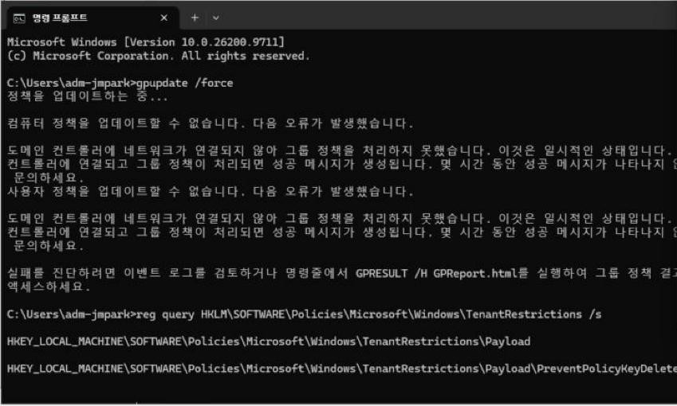

DC01을 켠 뒤 다시 실행하자 성공했다. `HKLM\SOFTWARE\Policies\Microsoft\Windows\TenantRestrictions\Payload`에 `tenantid`, `policyid`가 들어갔고, `cloudid`·`hostnames`·`subdomainSupportedHostnames`·`ipRanges`는 비어 있다. 하위 키 `PreventPolicyKeyDelete`도 생겼다.

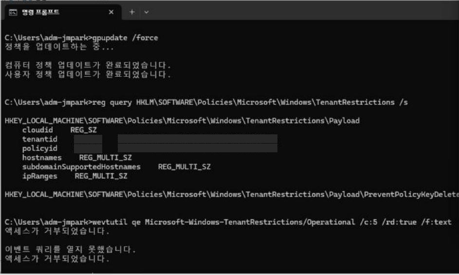

관리자 권한이 아닌 명령 프롬프트에서 `wevtutil qe Microsoft-Windows-TenantRestrictions/Operational`은 "액세스가 거부되었습니다"로 실패했다. 이벤트 뷰어로 보면 1004(13:19:36, 엔드포인트 동기화 서비스 `cloudidsvc` 시작)와 1005(13:19:40, 최신 엔드포인트 목록 동기화)가 남았다.

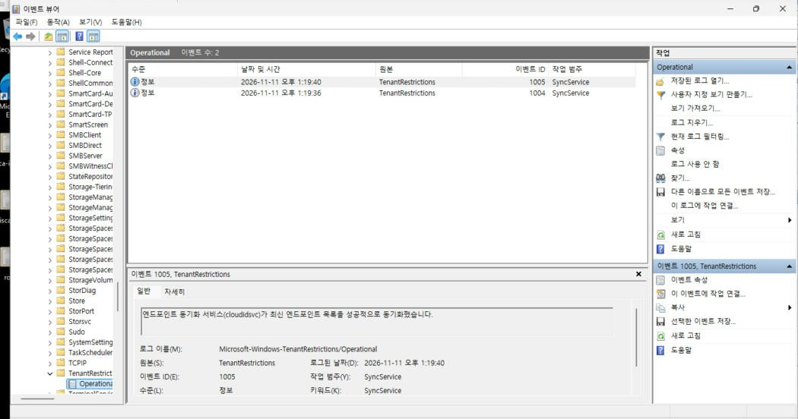

### 2-3. 결과

Edge InPrivate에서 `https://copilot.cloud.microsoft`로 로그인했다.

| 계정 | 결과 |
|---|---|
| 개인 Microsoft 계정 | 차단, `80045C4D` (04:21:43Z) |
| 홈랩 관리자 (허용 조직) | 로그인됨 |
| 샌드박스 사용자 | 로그인됨 |

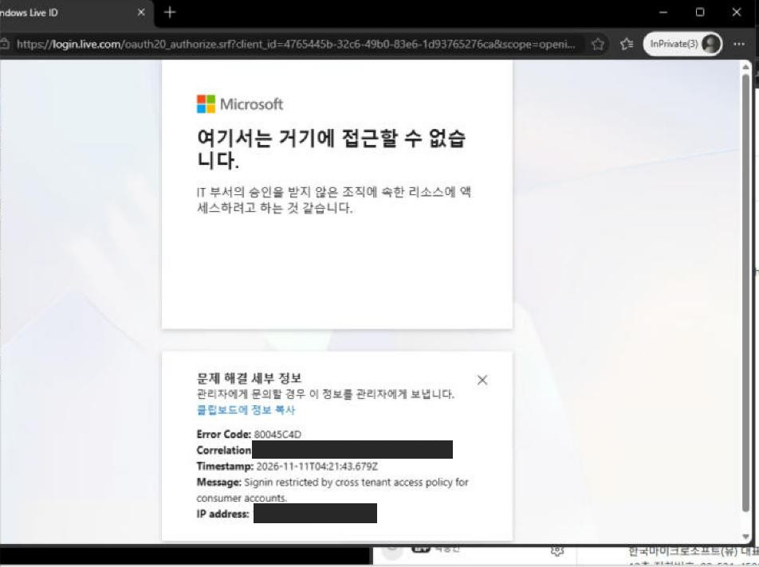

메시지는 1편과 같은 `Signin restricted by cross tenant access policy for consumer accounts.`다. 홈랩 관리자 계정은 로그인 후 Copilot 검색 화면에 "목록을 로드하는 동안 문제가 발생했습니다"가 떴다. 인증은 통과했으므로 TRv2 차단은 아니며, 원인은 확인하지 않았다. 차단된 시도에 대한 이벤트는 Operational 로그에 남지 않았다.

## 3. 유니버설 TRv2 — Global Secure Access

### 3-1. 문서 기준 요건과 순서

| 항목 | 공식 문서 내용 |
|---|---|
| 신호 방식 | GSA가 모든 트래픽에 태그를 붙인다. 운영 체제·브라우저·장치 형태와 무관. 인증 단계 보호, 데이터 단계는 Microsoft Graph만 |
| 역할 | 기능 관리: Global Secure Access Administrator. 유니버설 TR 토글: Global Secure Access Administrator + Security Administrator |
| 트래픽 프로필 | Microsoft 트래픽 프로필을 켜야 하고, Entra ID 서비스 FQDN·IP가 Tunnel이어야 한다 |
| 클라이언트 | 온보딩된 테넌트에 Entra 조인·하이브리드 조인 장치. Entra 등록 장치는 Private Access만 지원. 64비트 Windows 10(LTSC 2021 이상)·11, 설치에 로컬 관리자 권한 |
| 실패 시 동작 | 클라이언트가 서비스에 연결하지 못하면 트래픽은 차단이 아니라 **우회(bypass)**된다 |
| 알려진 문제 | 유니버설 TR을 켠 뒤 허용 목록 테넌트의 Entra 관리 센터가 "Access denied"일 수 있다. URL에 `?feature.msaljs=true&exp.msaljsexp=true`를 붙인다 |

`WIN11-CL01`은 홈랩 테넌트에 하이브리드 조인된 장치라 샌드박스 GSA에 쓸 수 없다. 샌드박스에 Entra 조인된 `WIN10-CL01`을 썼다. 문서 문구가 "Windows 10 (LTSC 2021 or newer)"라 일반 22H2 Pro가 대상인지는 문서만으로 확정하지 못했고, 설치해 보고 판단했다. 설치와 연결은 문제없었다.

### 3-2. 포털 설정

| 순서 | 위치 | 동작 |
|---|---|---|
| 1 | Global Secure Access 시작 화면 | "활성화"로 테넌트 온보딩 (몇 분 소요) |
| 2 | Global Secure Access → 연결 → 트래픽 전달 | **Microsoft 트래픽 프로필** 켜기. 사용자·그룹 범위는 지정하지 않음 |
| 3 | Global Secure Access → 설정 → 세션 관리 → 유니버설 테넌트 제한 탭 | "Microsoft Entra ID 및 Microsoft Graph에 대한 테넌트 제한 활성화" 켜기 |

트래픽 전달 화면 위쪽의 "트래픽 전달 프로필 v2"(미리 보기) 전환은 하지 않았다. 프라이빗 액세스·인터넷 액세스 프로필에는 "테넌트에 이 프로필을 사용하는 데 필요한 라이선스가 없습니다"가 표시된다. Microsoft 트래픽 프로필은 Entra ID P1 범위라 그대로 켜졌다.

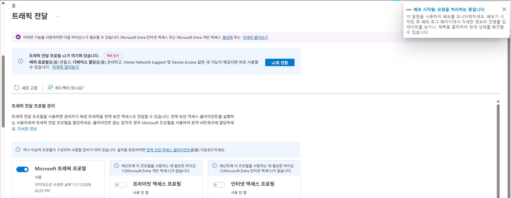

### 3-3. 클라이언트 설치와 연결

포털 연결 → 클라이언트 다운로드에서 받은 `GlobalSecureAccessClient.exe`를 샌드박스 사용자로 로그인한 VM에서 설치했다. 설치는 "Installation Successfully Completed"로 끝났지만 상태는 **Signed out**("No user is signed in")이었다. 고급 진단(트레이 아이콘 우클릭 → Advanced diagnostics)의 Health check 결과는 아래와 같다.

| 결과 | 항목 |
|---|---|
| True | 인터넷 연결, GSA 서비스 실행, 단일 사용자 세션, 정책 서비스 DNS·접근, DNS 응답, Secure DNS disabled |
| False | Forwarding profile valid, Client enabled by your organization, Diagnostic URLs in forwarding profile, Magic IP received, Cached user sign-in state present |

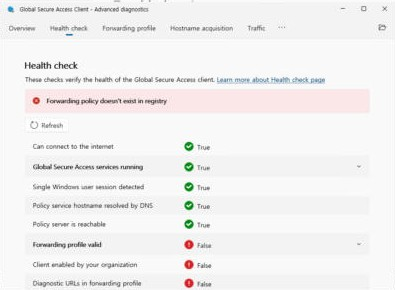

알림 센터에 "회사 또는 학교 계정 문제 — 이 알림을 선택하여 다시 로그인하세요"가 두 건 있었다.

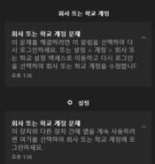

문서는 클라이언트가 Windows 로그인 사용자의 Entra 인증을 쓰므로 `dsregcmd /status`의 `AzureAdPrt : YES`를 확인하라고 한다. 설정 → 계정 → 회사 또는 학교 액세스에서 다시 로그인한 뒤 확인했다.

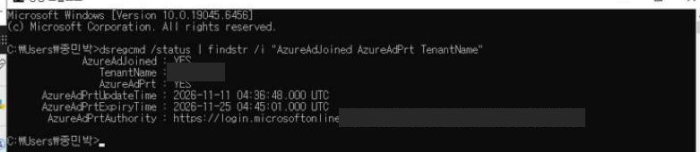

클라이언트 Troubleshooting → **Get policy**를 누르고 약 20초 뒤 Connected가 됐다. 채널은 Entra와 M365 두 개다.

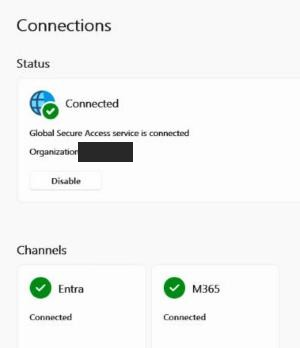

### 3-4. 클라이언트가 받은 규칙

고급 진단 Forwarding profile 탭에는 규칙이 Entra rules, Microsoft 365 rules 두 묶음으로 보인다. Policy tester로 두 로그인 주소를 넣어 봤다.

| FQDN:포트/프로토콜 | Action | Priority | Hardening |
|---|---|---|---|
| `login.live.com:443/TCP` | Tunnel | 9 | Bypass |
| `login.microsoftonline.com:443/TCP` | Tunnel | 4 | Bypass |

개인 계정 로그인 주소도 Microsoft 트래픽 프로필의 터널 대상이다. 결과 화면에는 "This tool doesn't evaluates FQDNs against IP rules"라는 안내가 붙는다. IP 규칙까지 포함한 판정은 아니다.

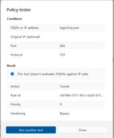

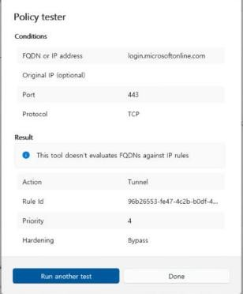

### 3-5. 첫 시험 (무효 처리)

Edge InPrivate에서 세 계정으로 시험했다.

| 계정 | 결과 |
|---|---|
| 개인 Microsoft 계정 | 차단, `80045C4D` (04:49:05Z) |
| 홈랩 관리자 | 로그인됨. Copilot이 `/chat/blocked` 화면으로 "Copilot Chat을 사용할 수 없습니다" 표시 |
| 샌드박스 사용자 | 로그인됨 |

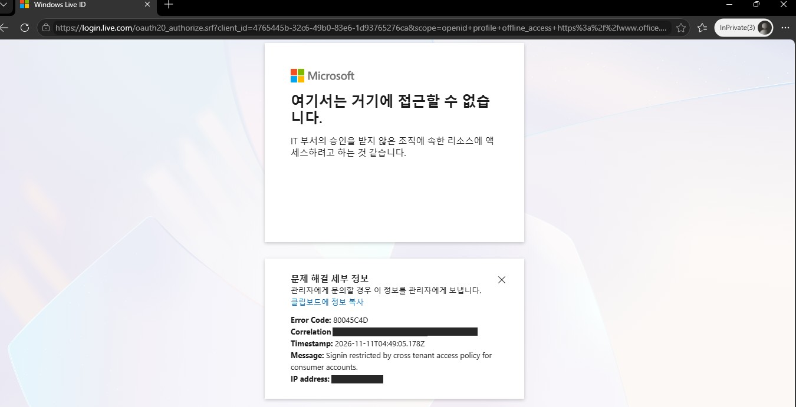

홈랩 계정 화면은 로그인을 마친 뒤 Copilot 앱이 보여준 안내다. TRv2 차단이라면 로그인 단계에서 개인 계정과 같은 오류 페이지가 나와야 한다. 원인은 확인하지 않았다.

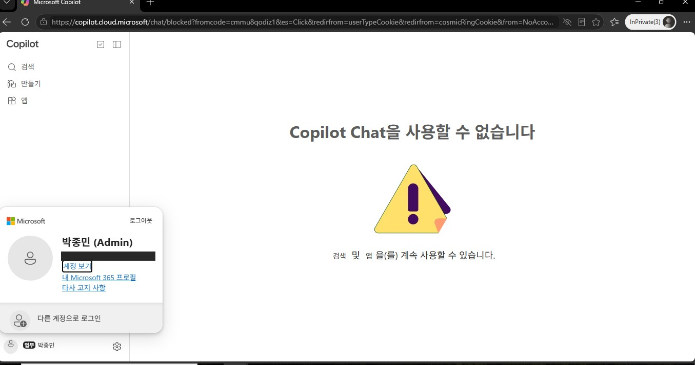

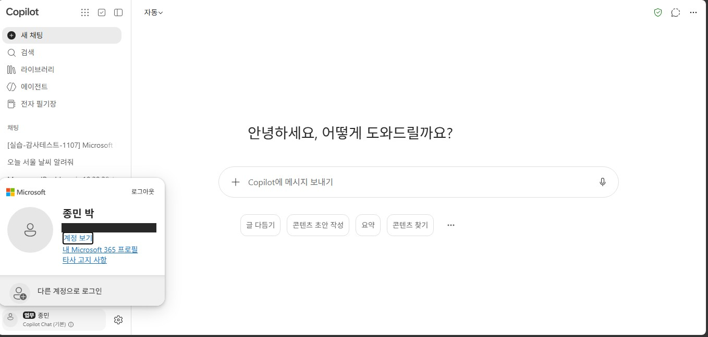

결과를 정리하다 `WIN10-CL01`의 레지스트리를 확인했다. 1편에서 켠 로컬 GPO 값이 그대로 남아 있었다. 1편 원복표에는 "사용 안 함"으로 되돌린다고 적었지만 실제로는 하지 않은 상태였다.

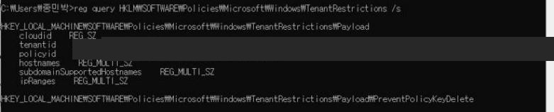

GPO 신호와 GSA 신호가 함께 있었으므로 첫 시험 결과로는 GSA 효과를 말할 수 없다. 이 시험은 무효로 두고 다시 했다. 대신 이 시험에서 확인한 클라이언트·로그 동작은 아래 3-7에 적었다.

### 3-6. GPO 끄고 재시험

| 순서 | 작업 | 확인 |
|---|---|---|
| 1 | `gpedit` 클라우드 정책 세부 정보: 사용 → **사용 안 함** | 목록의 상태 열 "사용 안 함" |
| 2 | `gpupdate /force` | `Payload` 키만 남고 값 없음 |
| 3 | 재부팅 후 다시 로그인 | `Payload` 값 없음, `AzureAdPrt : YES` |

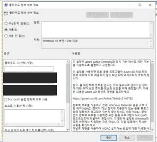

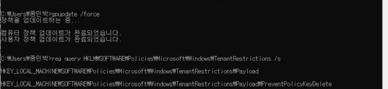

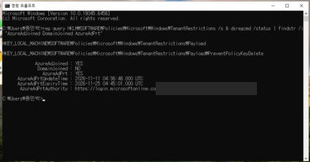

재시험 전에 문제가 하나 더 있었다. 첫 시험 뒤 원복하면서 포털에서 Microsoft 트래픽 프로필을 껐다가(14:24) 다시 켰는데(14:31), 클라이언트는 **Disabled by your organization** 상태로 남았다.

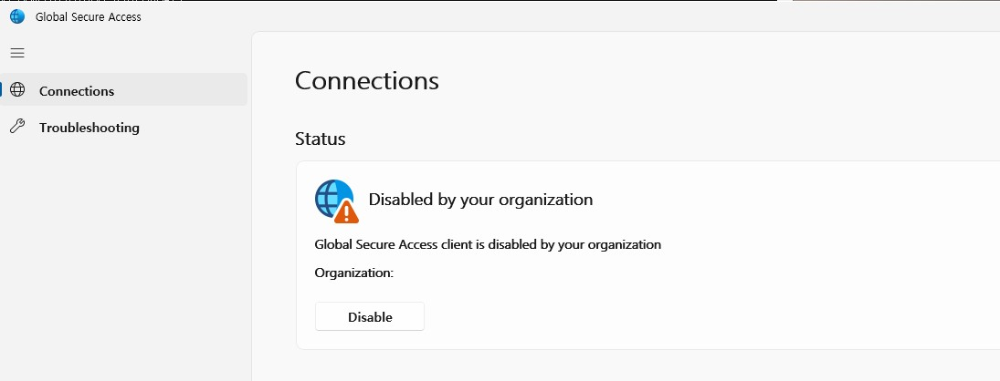

`HKLM\SOFTWARE\Microsoft\Global Secure Access Client`의 `ForwardingProfile` 값을 보면 정책 버전이 `CPLM:20261111052440`(UTC 05:24:40, 껐을 때)이고 `"channels":[]`였다. 문서의 강제 재수신 절차대로 진행했다.

| 문서 절차 | 실제 |
|---|---|
| `ForwardingProfileTimestamp` 레지스트리 키 삭제 | 이 버전에서는 하위 키가 아니라 같은 경로의 **값**(REG_SZ)이었다. 값을 삭제 |
| "Global Secure Access Policy Retriever Service" 재시작 | 이 이름의 서비스가 없었다. 서비스는 Client Manager, Engine, Forwarding Profile, Tunneling 4개. Forwarding Profile, 이후 4개 모두 재시작 |
| 두 값이 다시 생기는지 확인 | 바로 생기지 않았다 |

```powershell
Get-Service GlobalSecureAccess* | Format-Table Name, DisplayName, Status
# GlobalSecureAccessClientManagerService    Global Secure Access Client Manager Service
# GlobalSecureAccessEngineService           Global Secure Access Engine Service
# GlobalSecureAccessForwardingProfileService Global Secure Access Forwarding Profile Service
# GlobalSecureAccessTunnelingService        Global Secure Access Tunneling Service
```

포털에서 다시 켠 지 약 20분 뒤(14:52) 새 정책이 들어왔다. 정책 버전은 `CPLM:20261111053508`(UTC 05:35:08)이다. 문서 기준 반영 시간은 "1시간 이내"다. 처음 켰을 때는 4분 만에 반영됐다.

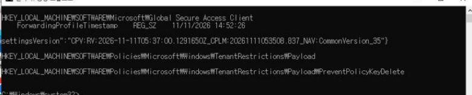

GSA만 켜진 상태에서 개인 계정으로 `https://outlook.live.com`에 로그인했다. 1편 7장과 같은 URL이다.

| 브라우저 | 결과 | 시각 (UTC) |
|---|---|---|
| Edge InPrivate | 차단, `80045C4D` | 05:56:28 |
| Chrome 시크릿 | 차단, `80045C4D` | 05:58:08 |

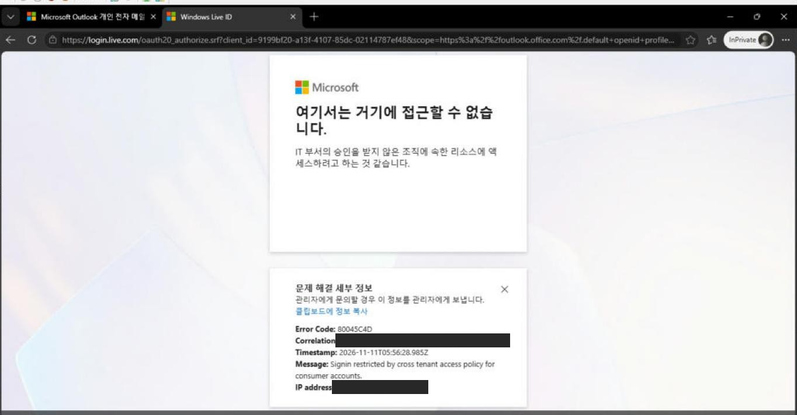

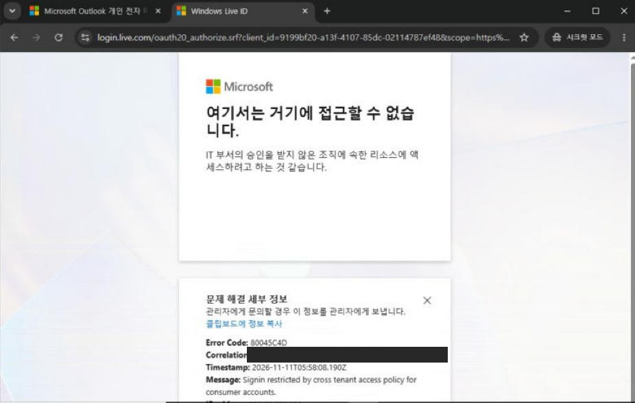

1편에서 GPO 방식일 때 같은 개인 계정은 Chrome 시크릿 창에서 Outlook 메일함까지 들어갔다. 신호를 붙이는 위치가 브라우저(Edge)에서 네트워크 클라이언트(GSA)로 바뀌면서 Chrome도 같은 정책을 받았다.

재시험에서는 홈랩 관리자·샌드박스 계정을 다시 시험하지 않았다. 두 계정은 첫 시험과 2단계에서 로그인됐고, 정책을 바꾸지 않았기 때문이다.

### 3-7. 트래픽이 실제로 터널을 탔는지

#### 포털 트래픽 로그

Global Secure Access → 모니터 → 트래픽 로그(미리 보기)에서 대상 FQDN을 `login.live.com`으로 걸렀다. 처음 열었을 때(14:00경)는 비어 있었고, 몇십 분 뒤 다시 보니 13:46 이후 기록이 모두 들어와 있었다. 문서에는 반영 지연 시간이 적혀 있지 않다.

| 시각 (KST) | 시험 | 채널 | 대상 IP | 동작 |
|---|---|---|---|---|
| 13:49:05.067 | 첫 시험 Edge (오류 13:49:05.178) | Entra | 40.126.35.21 | 허용 |
| 14:10:41.417 | 첫 시험 반복 (오류 14:10:41) | Entra | 40.126.35.19 | 허용 |
| 14:56:05 ~ 14:56:08 | 재시험 Edge | Entra | 20.190.144.139 외 | 허용 |
| 14:57:57, 14:58:02 | 재시험 Chrome | Entra | 40.126.16.164 외 | 허용 |

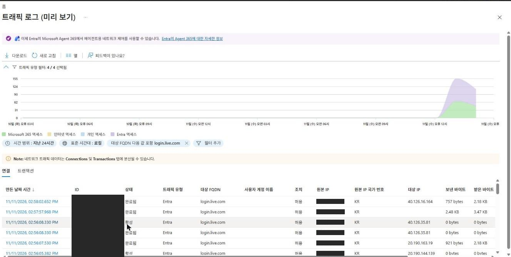

동작이 "허용"이고 차단 트랜잭션 수가 0인 점이 처음에는 헷갈렸다. 문서상 연결(Connection)은 같은 흐름 ID를 가진 트랜잭션 묶음이고, 차단된 트랜잭션 수는 따로 표시된다. GSA는 연결을 통과시켰고, 차단은 로그인 서버가 오류 페이지를 돌려준 것이다. 네트워크 계층에서는 정상 연결로 남는다. "TRv2 차단이 GSA 로그에 허용으로 기록된다"는 문장이 문서에 있는 것은 아니고, 관측 결과다.

출발지 IP는 차단 화면의 "IP address"와 같은 공인 IP였다. Entra 채널 항목에는 사용자 계정 이름이 비어 있고, Microsoft 365 채널 항목에는 샌드박스 사용자가 찍혀 있었다.

#### 클라이언트 고급 진단

Hostname acquisition 탭은 OS DNS 조회 중 GSA가 가로챈 이름을 보여준다. 첫 시험을 반복할 때 `ipconfig /flushdns` 후 Edge를 새로 열어 시도했는데, login.microsoftonline.com·graph.microsoft.com·m365.cloud.microsoft 등은 Acquired=Yes로 잡혔지만 **login.live.com은 조회 기록 자체가 없었다**. 같은 시간대에 `dns.google`(8.8.4.4) 조회가 있었다.

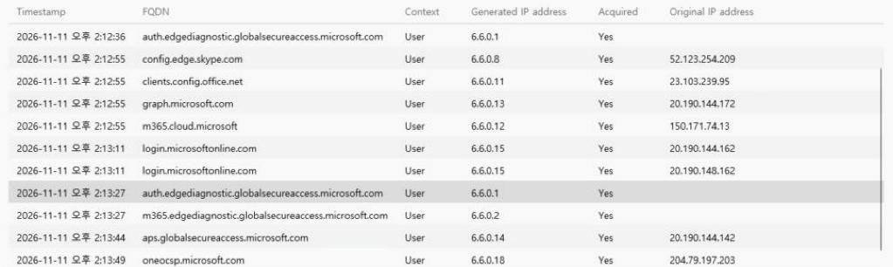

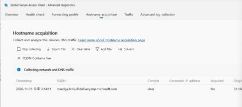

Traffic 탭(Action=Tunnel, 프로세스 msedge.exe)에서는 같은 시각 20.190.x.x, 40.126.x.x로 가는 연결이 **FQDN 없이** Channel "Entra Authentication"으로 터널됐다.

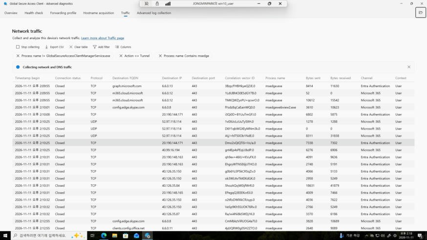

Microsoft 365 URL·IP 목록 기준으로 `20.190.128.0/18`, `40.126.0.0/18`은 ID 56(login.microsoftonline.com 등 Entra ID 인증) 대역이다. login.live.com은 ID 56이 아니라 ID 97·116(선택 항목)에 나온다. 정리하면 이렇다.

- 확인한 것: Edge의 로그인 연결은 이름 규칙이 아니라 IP 규칙으로 터널됐다. 이 클라이언트 쪽 흐름 ID(Correlation vector ID)와 포털 로그의 흐름 ID가 같았고, 포털에서는 그 흐름이 login.live.com으로 표시됐다.
- 확인하지 못한 것: Edge가 login.live.com을 OS DNS 대신 어디서 풀었는지. `WIN10-CL01`의 DNS 서버는 이전 실습에서 8.8.8.8·1.1.1.1로 바꿔 둔 상태였다. Edge의 보안 DNS가 원인일 가능성이 있지만 확인하지 않았다.

이 차이는 실무에서 의미가 있다. 공용 DNS와 브라우저 보안 DNS를 쓰는 단말에서 FQDN 규칙만으로 터널을 기대하면 빠지는 연결이 생길 수 있다. 이번에는 Entra 인증 IP 대역이 IP 규칙으로 함께 들어 있어서 결과가 같았다.

## 4. 정리

### GPO 방식과 GSA 방식 비교 (이번 실측 기준)

| 항목 | Windows GPO (1편, 2단계) | 유니버설 TRv2 (3단계) |
|---|---|---|
| 신호 위치 | Windows (Edge·Office·UWP) | GSA 클라이언트 (네트워크) |
| 개인 계정, Edge | 차단 `80045C4D` | 차단 `80045C4D` |
| 개인 계정, Chrome | **로그인됨** | **차단** |
| 단말 요건 | Windows 10 21H2 이상 등 (Policy CSP) | 해당 테넌트에 Entra 조인·하이브리드 조인, 클라이언트 설치 |
| 확인 위치 | 레지스트리 `Payload`, TenantRestrictions Operational 로그 | 클라이언트 Health check·Traffic 탭, 포털 트래픽 로그 |
| 실패 시 | 신호 없음 → 정책 미적용 | 서비스 연결 실패 → 트래픽 우회(bypass) |

### 운영에서 볼 것

- 단말 하나에 GPO 신호와 GSA 신호가 동시에 있으면 어느 쪽이 차단했는지 분리되지 않는다. 시험 전 `reg query HKLM\SOFTWARE\Policies\Microsoft\Windows\TenantRestrictions /s`로 GPO 값을 먼저 확인한다.
- GSA 클라이언트는 설치 직후 Windows 계정의 PRT 상태에 따라 Signed out일 수 있다. `dsregcmd /status`의 `AzureAdPrt`와 알림 센터의 회사 계정 알림을 같이 본다.
- 클라이언트가 연결되지 않으면 트래픽은 막히지 않고 우회된다. "차단 안 됨"이 나오면 정책보다 클라이언트 상태를 먼저 본다.
- 포털 변경은 클라이언트 반영에 시간이 걸린다. 이번에는 처음 4분, 끄고 다시 켰을 때 약 20분이었다. 문서의 강제 재수신 절차는 서비스 이름·레지스트리 형태가 현재 클라이언트와 달랐다.
- TRv2로 막힌 로그인도 GSA 트래픽 로그에는 "허용"으로 남는다. 차단 근거는 로그인 오류 화면(상관 관계 ID, 시각)과 트래픽 로그 시각을 맞춰서 남긴다.
- 개인 계정 차단 로그가 어느 테넌트 로그인 로그에 남는지는 문서에 설명이 없다. 문서는 B2B 사용자와 서비스 주체 경우만 다룬다.

### 하지 않은 것

- 차단된 로그인을 Entra 로그인 로그에서 찾는 것
- 미승인 테넌트 계정(`AADSTS5000211`)을 GSA 단독 상태에서 재시험
- Microsoft Graph 데이터 단계 보호 확인
- 원격 네트워크(지사) 연결 방식, 모바일 클라이언트
- 프록시 헤더 방식

### 원복

| 대상 | 원복 | 상태 |
|---|---|---|
| 유니버설 테넌트 제한 토글 | 끄기 | 완료 |
| Microsoft 트래픽 프로필 | 사용 안 함 | 완료 (15:05) |
| GSA 테넌트 활성화 | 문서에 비활성화 절차가 없음. 트래픽 프로필이 모두 꺼져 전달되는 트래픽 없음 | 유지 |
| WIN10-CL01 GSA 클라이언트 | 설정 → 앱에서 제거 | 진행 예정 |
| WIN10-CL01 로컬 GPO (1편) | 사용 안 함 + `gpupdate /force` + 재부팅 | 완료 (11-11) |
| WIN11-CL01 로컬 GPO | 구성되지 않음 + `gpupdate /force` | 진행 예정 |
| TRv2 기본 정책·조직 설정 | 변경하지 않음 | — |

## 참고

- [Set up tenant restrictions v2 - Microsoft Learn](https://learn.microsoft.com/entra/external-id/tenant-restrictions-v2)
- [Universal tenant restrictions - Microsoft Learn](https://learn.microsoft.com/entra/global-secure-access/how-to-universal-tenant-restrictions)
- [Manage the Microsoft traffic forwarding profile - Microsoft Learn](https://learn.microsoft.com/entra/global-secure-access/how-to-manage-microsoft-profile)
- [Install the Global Secure Access client for Windows - Microsoft Learn](https://learn.microsoft.com/entra/global-secure-access/how-to-install-windows-client)
- [Global Secure Access client diagnostics: Health check - Microsoft Learn](https://learn.microsoft.com/entra/global-secure-access/troubleshoot-global-secure-access-client-diagnostics-health-check)
- [Global Secure Access client advanced diagnostics - Microsoft Learn](https://learn.microsoft.com/entra/global-secure-access/troubleshoot-global-secure-access-client-advanced-diagnostics)
- [Global Secure Access traffic logs - Microsoft Learn](https://learn.microsoft.com/entra/global-secure-access/how-to-view-traffic-logs)
- [Microsoft 365 URLs and IP address ranges - Microsoft Learn](https://learn.microsoft.com/microsoft-365/enterprise/urls-and-ip-address-ranges)
- [Manage the local administrators group on Microsoft Entra joined devices - Microsoft Learn](https://learn.microsoft.com/entra/identity/devices/assign-local-admin)
